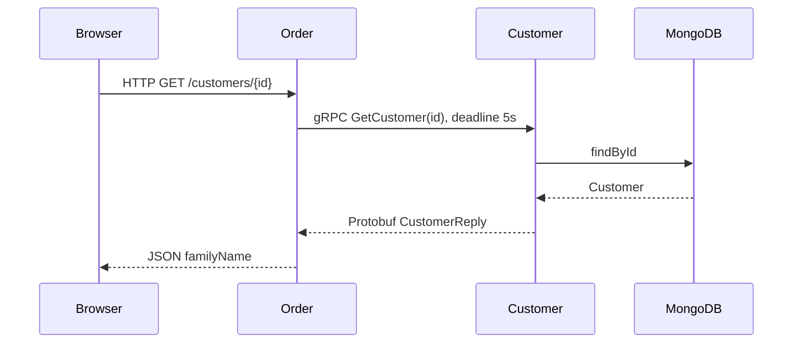

# gRPC: order service → customer service

## Slide 1 — Goal
Keep the public HTTP API and use gRPC for internal customer lookups.
`GET /customers/{id}` → order service → gRPC → customer service → MongoDB.

## Slide 2 — Contract first
`grpc-contract/src/main/proto/customer.proto` defines messages and RPCs.
Gradle generates Java messages, the server base class, and the client stub.
Both services depend on one contract; never edit generated Java files.

## Slide 3 — Two RPC patterns
- GetCustomer: unary request and response; validates UUID and returns NOT_FOUND for missing customers.
- ListCustomers: one request, a stream of customer replies.
The order adapter converts callbacks into Reactor Mono/Flux without blocking HTTP event loops.

## Slide 4 — Architecture


## Slide 5 — Run the demo
From the repository root, use separate terminals:
```sh
./gradlew :microservices:customer-service:customer-service-main:bootRun
./gradlew :microservices:order-service:order-service-main:bootRun
```
Start the existing MongoDB, PostgreSQL and Consul dependencies as required by application configuration.
The customer gRPC server listens on 9093. Order defaults to gRPC; override
`CUSTOMER_GRPC_TARGET=host:9093` when services run on different hosts.
Use the configured order HTTP port (check its application.yaml):
```sh
curl http://localhost:9092/customers
curl http://localhost:9092/customers/REPLACE_WITH_EXISTING_CUSTOMER_UUID
```
Direct RPC calls (install grpcurl separately; reflection is not required):
```sh
grpcurl -plaintext -import-path grpc-contract/src/main/proto -proto customer.proto localhost:9093 customer.v1.CustomerService/ListCustomers
grpcurl -plaintext -import-path grpc-contract/src/main/proto -proto customer.proto -d '{"id":"invalid"}' localhost:9093 customer.v1.CustomerService/GetCustomer
```
Expect INVALID_ARGUMENT for the second call. Use an existing UUID for success,
and a valid missing UUID for NOT_FOUND. The order HTTP response retains its existing familyName-only shape.

## Slide 6 — Tradeoffs and next steps
Protobuf supplies typed contracts and binary serialization; gRPC supports streaming.
Actual latency improvements require measurement. This demo uses plaintext on a trusted local network.
Production work includes TLS/authentication, discovery of the gRPC port, mapping RPC failures to HTTP statuses,
and bounded streaming flow control. The current stream bridge buffers slow consumers.
HTTP comparison: restart order with CUSTOMER_TRANSPORT=http. The existing customer list HTTP endpoint
currently throws a DomainException, so use a single customer lookup for comparison.

Reference: https://grpc.io/docs/languages/java/generated-code/
